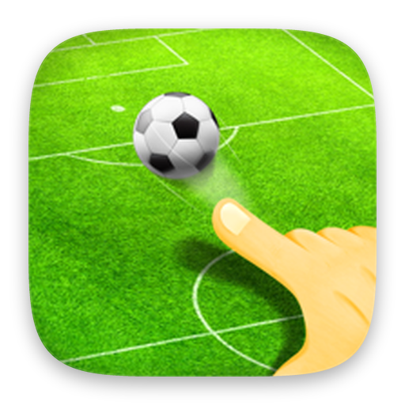

  

<h1 align="center">Penalty 2D</h1>

Flick the ball into the goal and reach the target score for each of 211 countries.

  
  &nbsp;
  

Godot 4 · GDScript · WebRTC multiplayer

## About the code

I wrote the game in 2022 and 2023 in Godot 3. The move to Godot 4 and the online PvP mode in 2026 were made with AI coding agents.

Art, sounds, fonts and third-party addons are not included, so the game can't be built from this repo.

© 2022–2026 Indest OÜ. All rights reserved.
